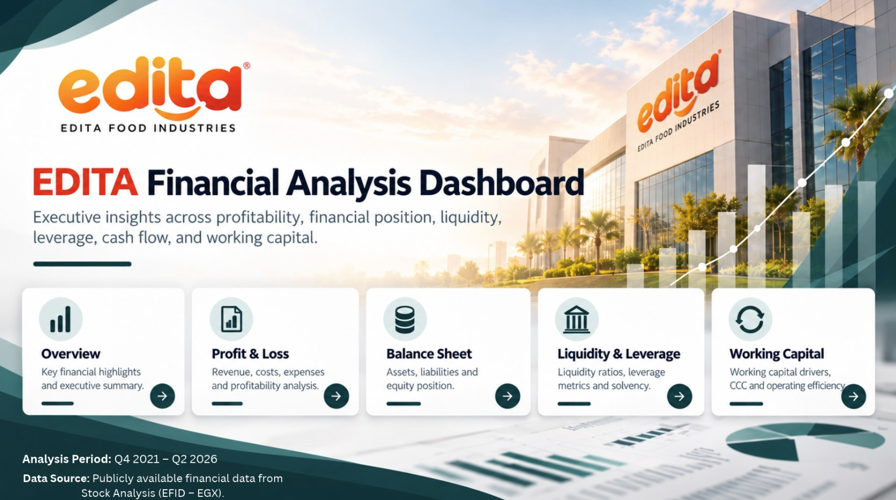
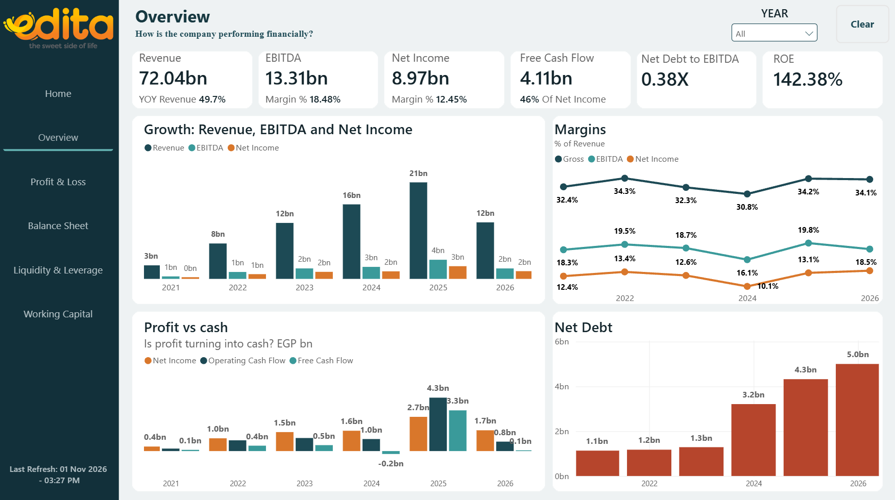
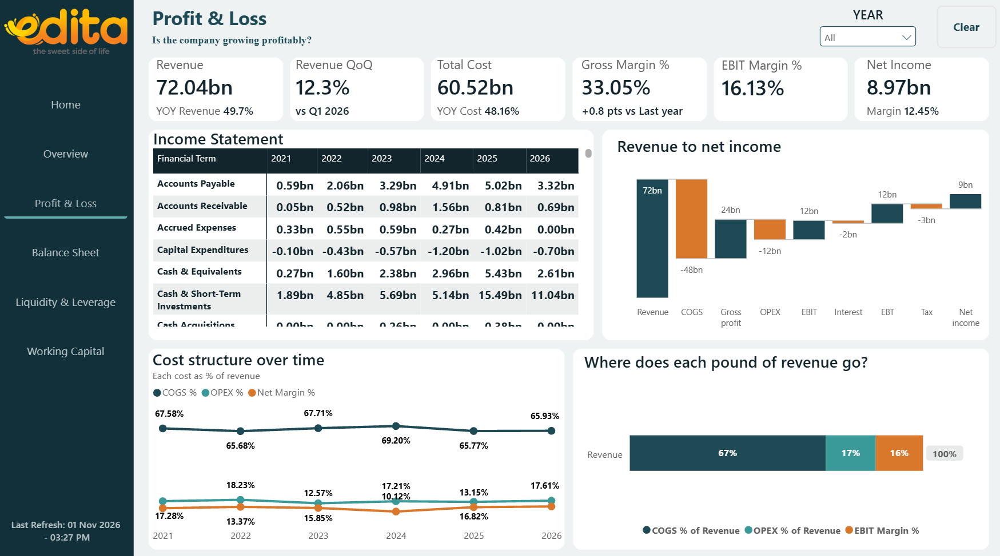
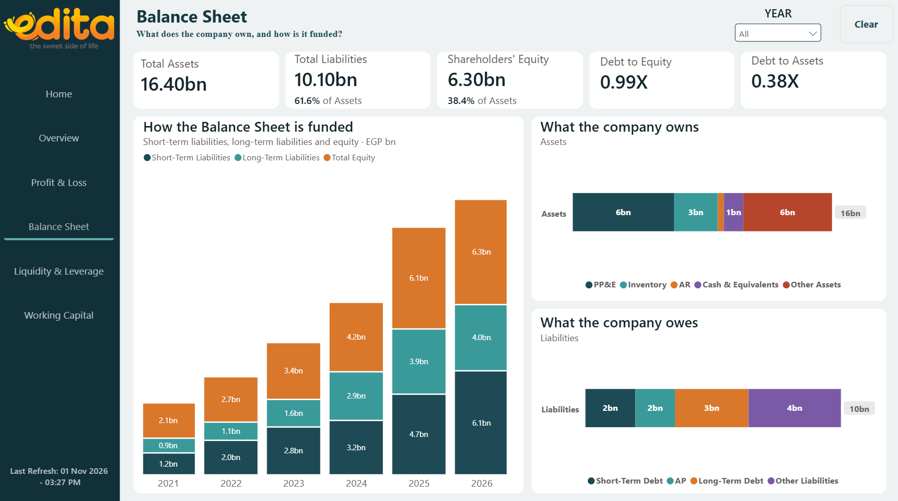
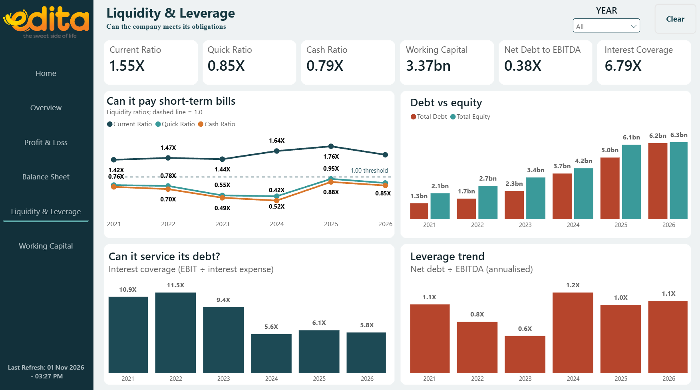
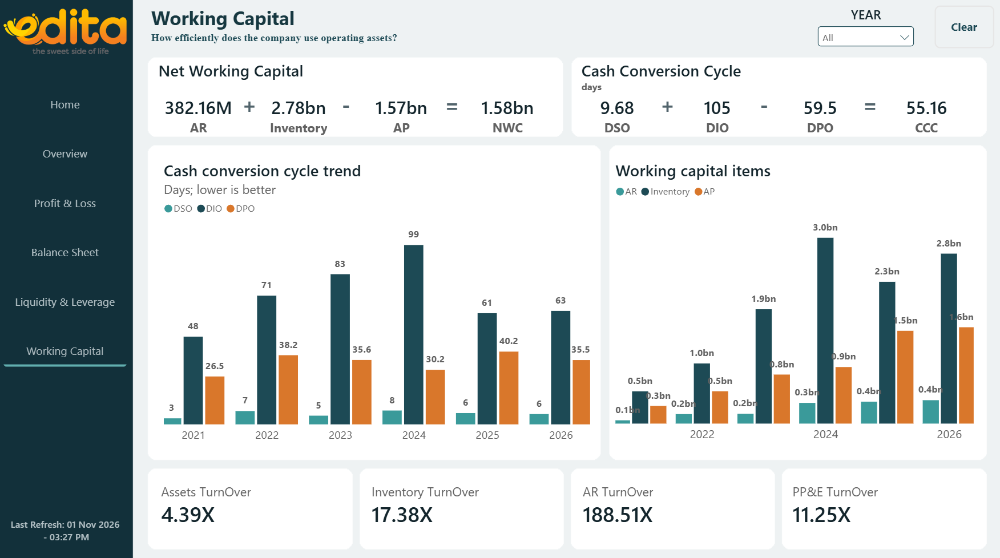

# EDITA Financial Analysis Dashboard | Power BI

> Independent financial analysis portfolio project examining the financial performance, position, liquidity, leverage and working capital of **EDITA Food Industries** (EGX: EFID). This is **not** an official EDITA report or affiliated project.

## Project overview

An interactive, multi-page Power BI report presenting financial trends and key ratios for the period **Q4 2021–Q2 2026**, as labelled in the dashboard. The visualizations organize a financial review into five analytical sections: executive overview, profit and loss, balance sheet, liquidity and leverage, and working capital.

**Tools:** Microsoft Power BI | Financial statement analysis | Financial KPIs | Interactive reporting

**Source noted in the dashboard:** Public financial data from *Stock Analysis* for EDITA Food Industries (EFID, EGX). The figures and latest refresh timestamp shown are reproduced from the author's dashboard screenshots and have **not been independently reconciled** to audited financial statements.

## Dashboard pages

### 1. Executive overview

Revenue, EBITDA, net income, free cash flow, margins, cash conversion and net debt trends are presented on a consolidated overview page.

### 2. Profit & loss

Revenue growth, cost structure, operating profitability and a revenue-to-net-income bridge, alongside a period-by-period financial statement table.

### 3. Balance sheet

Asset composition, liabilities, shareholders' equity and funding structure over time.

### 4. Liquidity & leverage

Short-term liquidity ratios, debt and equity, interest coverage, and leverage trends.

### 5. Working capital

Receivables, inventory and payables drivers; net working capital; cash conversion cycle (CCC); and turnover indicators.

## Selected dashboard KPIs

*Values below are **as displayed** in the screenshots with the year filter set to “All”. They are not necessarily all comparable annual figures.*

| Indicator | Displayed value |
| --- | ---: |
| Revenue | EGP 72.04bn |
| EBITDA | EGP 13.31bn |
| Net income | EGP 8.97bn |
| Free cash flow | EGP 4.11bn |
| Gross margin | 33.05% |
| EBIT margin | 16.13% |
| Total assets | EGP 16.40bn |
| Total liabilities | EGP 10.10bn |
| Shareholders' equity | EGP 6.30bn |
| Current ratio | 1.55x |
| Quick ratio | 0.85x |
| Net debt / EBITDA | 0.38x |
| Interest coverage | 6.79x |
| Cash conversion cycle | 55.16 days |

## Analytical observations

- The report separates **profitability** from **cash generation**, helping assess the quality of reported earnings.
- The **current ratio is above 1.0x** while the **quick ratio is below 1.0x** in the selected view, suggesting that the liquidity assessment depends meaningfully on less-liquid current assets; this is not, by itself, a solvency conclusion.
- The dashboard illustrates a rise in displayed **net debt** across the years shown, providing a useful subject for further analysis of capital structure and debt service capacity.
- The working capital page connects inventory and payables to the **cash conversion cycle**, encouraging operational interpretation rather than looking at the current ratio alone.

## Interpretation and validation notes

- **Period comparability:** The dashboard covers through **Q2 2026**. Annual 2026 and prior-year bars should not be interpreted as directly comparable until the report's annualization, fiscal-period and TTM logic is confirmed.
- **Aggregation context:** KPI cards are displayed with **YEAR = All**; sums across periods and end-of-period balance-sheet values should be distinguished before deriving financial conclusions.
- **Definitions:** Verify DAX definitions for *Total Cost*, gross margin, net debt, free cash flow, debt/equity and net working capital against the source statements. A total-cost figure should not automatically be interpreted as COGS.
- **Rounding:** Displayed cash conversion cycle inputs (9.68 + 105 − 59.5) yield approximately **55.18 days**, versus **55.16 days** shown. This can result from rounding of underlying inputs and should be checked at full precision.
- **Data source / branding:** Company names and logos identify the subject of analysis only; there is no claim of endorsement or official affiliation.

## Files

- `README.md` — project summary and embedded report previews
- `home.png`, `overview.png`, `profit-and-loss.png`, `balance-sheet.png`, `liquidity-and-leverage.png`, `working-capital.png` — screenshots
- `EDITA.pbix` — Power BI source file (**upload separately from the existing repository**; not included in this package)

## How to explore

Review the screenshots above, or download `EDITA.pbix` and open it using Power BI Desktop, if the source file and associated data are available and permitted to be shared. A hosted interactive report link can be added later if publication rights and settings allow it.

---

*Portfolio case study for educational and demonstration purposes. Financial information is subject to the original source, reporting periods and calculation methodology.*
